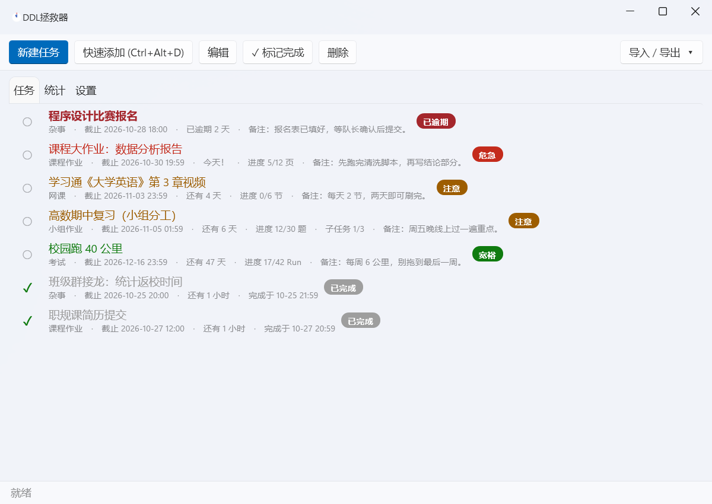
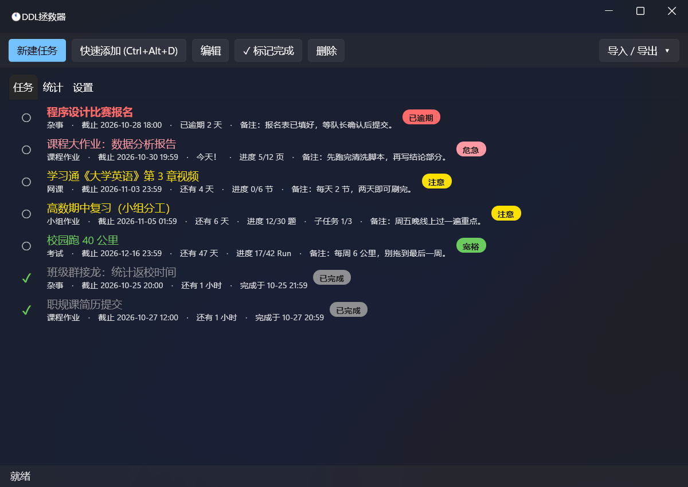
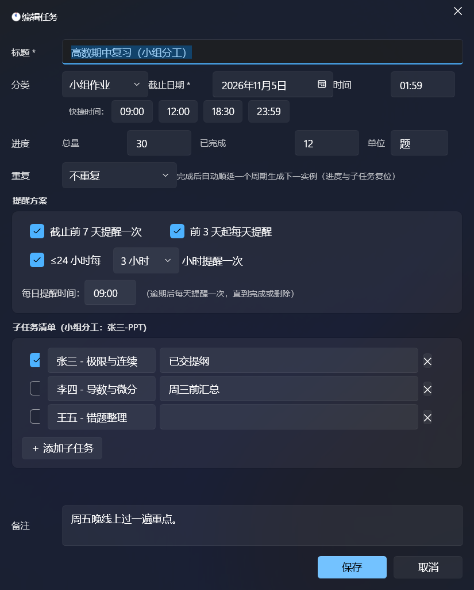
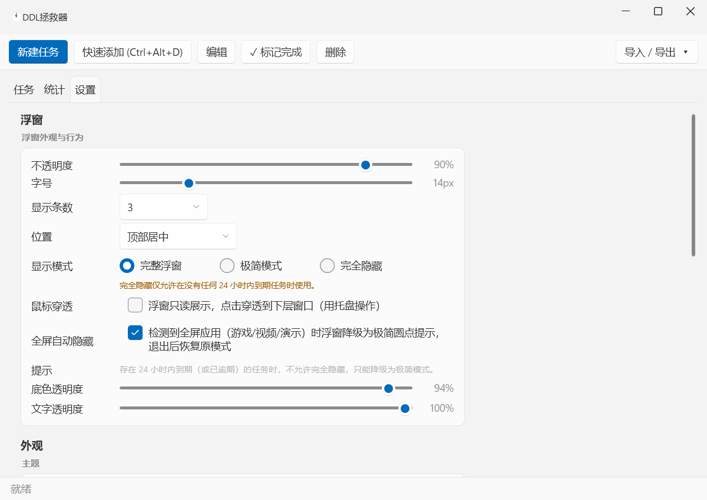
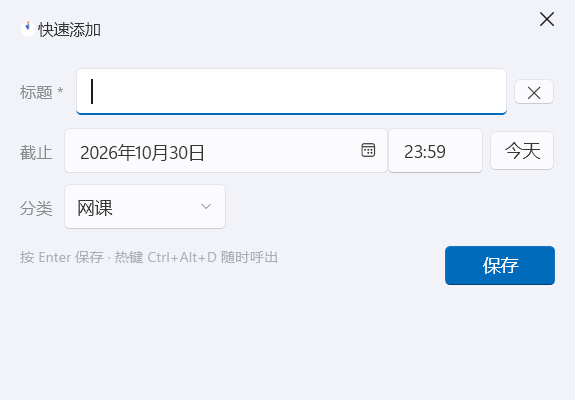

# DDL拯救器

[](https://github.com/Lyrissonare/DDL_Saver/releases/latest)
[](LICENSE)
[](https://github.com/ErSanSan233/IIIA)

一款长期驻留 Windows 桌面的**极简 DDL（截止日期）提醒工具**：常驻浮窗随时看见「距离学习通第 3 章还有 3 天」，到点弹系统通知，双击浮窗即管理任务。

界面基于 **WPF-UI（Fluent 2）**：主窗口、任务编辑、快速添加与早报使用 FluentWindow，窗口背景支持**云母 / 亚克力 / 纯色**三种材质，浮窗保留逐像素透明能力；浅色 / 暗色主题即时切换。



- **录入快**：全局热键 Ctrl+Alt+D 呼出三字段「快速添加」，10 秒录完。
- **看得见**：屏幕顶层浮窗实时显示最紧急的 N 个任务，宽裕/注意/危急三色分级，≤1 天红色呼吸提醒，逾期深红置顶。
- **忘不掉**：前 7 天一次 + 前 3 天每天 + ≤24 小时每 3 小时提醒 + 逾期后每天提醒，全部可配；系统 Toast 失败时自动改为应用内右下角弹窗，**提醒永远不静默丢失**。
- **纯本地**：无任何联网功能，不申请管理员权限，数据只写 `%AppData%\DDLSaver\`。

平台：Windows 10 1809+ / Windows 11 64 位。云母 / 亚克力在 Windows 11 上效果最佳，Windows 10 自动回退为纯色背景。

## 下载

从 [Releases](https://github.com/Lyrissonare/DDL_Saver/releases/latest) 下载免安装的 `DDLSaver.exe`（单文件、win-x64、无需安装 .NET 运行时）。

---

## 界面预览

| 暗色 · 任务列表 | 暗色 · 任务编辑 |
| --- | --- |
|  |  |

| 浅色 · 设置页 | 浅色 · 快速添加 |
| --- | --- |
|  |  |

---

## 构建与运行

环境要求：**[.NET 8 SDK](https://dotnet.microsoft.com/download/dotnet/8.0)**（Windows 10/11，64 位）。

```powershell
# 还原依赖并构建
dotnet restore DDLSaver.sln
dotnet build  DDLSaver.sln -c Release

# 运行（需已安装 .NET 8 桌面运行时）
start .\DDLSaver\bin\Release\net8.0-windows10.0.19041.0\DDLSaver.exe
```

> 首次运行会在 **%AppData%\DDLSaver\** 创建 `data.json`（含 2 条示例任务）与 `settings.json`。

## 发布为单文件 self-contained exe

无需用户安装 .NET 运行时，直接分发一个 exe：

```powershell
dotnet publish DDLSaver\DDLSaver.csproj -c Release -r win-x64 --self-contained `
  -p:PublishSingleFile=true -p:IncludeNativeLibrariesForSelfExtract=true
```

产物：`DDLSaver\bin\Release\net8.0-windows10.0.19041.0\win-x64\publish\DDLSaver.exe`

- 单文件、免安装、免管理员权限；开机自启写入的是 **HKCU**（当前用户）Run 键。
- 任意目录均可运行；**移动 exe 后请重新双击运行一次**以刷新 Toast 用的开始菜单快捷方式（AUMID 按 exe 路径生成，见下文 FAQ）。

## 使用说明

### 浮窗（屏幕顶部常驻）

| 模式 | 说明 |
| --- | --- |
| 完整浮窗 | 显示最紧急的 N 条未完成任务（默认 3 条，可在主窗口设置 1–5）。每行颜色分级：>7 天绿 / 3–7 天黄 / <3 天红；≤1 天红 + 克制的呼吸闪烁（仅透明度 0.6↔1）；逾期深红置顶加粗。 |
| 极简模式 | 屏幕角落小圆点 + 数字（24 小时内到期任务数），可拖到任意位置。 |
| 完全隐藏 | **存在 ≤24 小时到期（或已逾期）任务时被禁止使用**，只能降级为极简模式——这是防拖延硬规则。 |

- 不透明度 30%–100%、字号、位置（顶部/底部/自由拖拽）、显示条数均可在主窗口「设置」调整；
  另外提供**底色透明度（0–100%）**与**文字透明度（30–100%）**两个独立游标，可以只留文字、不要卡片。
- **外观主题**：主窗口「设置 → 外观」可切换**浅色 / 暗色**模式与**窗口背景（云母 / 亚克力 / 纯色）**，浮窗、主窗口、编辑窗口、早报等全部界面即时生效；纯色在浅色下为纯白、暗色下为纯黑，兼容性最好。
- **双击**浮窗打开主窗口；**右键**弹出菜单（模式/穿透/早报/退出）。
- **鼠标穿透模式**（可开关）：浮窗变为纯展示层（Win32 `WS_EX_TRANSPARENT`），点击穿透到下层窗口，一切操作通过托盘图标完成。

### 任务管理（主窗口）

- 双击浮窗或托盘图标打开；任务默认按**紧急度排序**（剩余时间 → 压力值 = 剩余工作量 ÷ 剩余天数），逾期任务永远置顶。
- 工具栏：**新建任务**（主按钮）、快速添加、编辑、标记完成、删除；**导入 / 导出**集中在右侧下拉菜单。
- 字段：标题、分类（网课/小组作业/考试/课程作业/杂事）、截止时间（默认当天 23:59）、进度（可选：总量/已完成/单位）、重复（每周/每两周/每月）、子任务清单（标题+完成+备注，适合小组分工）、备注、提醒方案。
- 勾选完成 → 绿色对勾缩放动效 + 记录完成时间；**总量任务（设置了进度总量）每次勾选只计 1 次进度，计满总量才整体完成**；**重复任务完成时自动生成下一周期实例**（截止顺延、进度清零、子任务复位、提醒记录清空）。
- 全局热键 **Ctrl+Alt+D**：三字段快速添加小窗；冲突时托盘气泡提示，可在「设置 → 快捷键」点击输入框改键。

### 通知与早报

- 默认提醒规则（每任务可单独关/改）：截止前第 7 天一次 → 第 3 天起每天一次（默认 09:00）→ ≤24 小时每 3 小时一次 → 逾期后每天一次直到完成。
- 防重复：每任务按提醒类型持久化 `lastNotified`，重启不轰炸。
- 点击 Toast 打开主窗口并**定位到对应任务**。
- **今日早报**：跨天启动时汇总今日到期/明日到期/逾期任务/进度任务今日应完成量；可勾选「不再显示」。

### 全屏自动隐藏

检测到全屏应用（游戏/视频/演示，`SHQueryUserNotificationState` 为主 + 窗口矩形兜底，2 秒轮询）时，浮窗降级为极简小圆点提示（永不完全消失），且每次刷新重申 `HWND_TOPMOST`，避免被全屏窗口压住；退出全屏恢复原模式。

### 数据与备份

- 数据：`%AppData%\DDLSaver\data.json`（缩进 JSON、camelCase）；**每次保存前自动备份** `data.json.bak`，主文件损坏时启动自动恢复并提示。
- 设置：同目录 `settings.json`。
- 主窗口「设置 → 系统 / 导入导出」：导出 JSON、导出 CSV（UTF-8 BOM，Excel 友好）、导入 JSON（合并/替换两种）、导入 `.ics` 日历批量建任务、一键打开数据目录。

### 统计页

连续完成天数（当天完成 ≥1 即续期）、本周完成/本周到期、累计完成、当前逾期数，及最近完成记录。

---

## 技术实现（要点）

- .NET 8 + WPF，C# 12，单项目；NuGet 依赖：
  - [WPF-UI](https://github.com/lepoco/wpfui) 4.3.0（Fluent 2 控件、FluentWindow、Mica、主题字典）
  - [Hardcodet.NotifyIcon.Wpf](https://github.com/hardcodet/wpf-notifyicon) 2.0.1（托盘）
  - [CommunityToolkit.WinUI.Notifications](https://github.com/CommunityToolkit/WindowsCommunityToolkit) 7.1.2（Toast）
- **主题**：`App.xaml` 合并 WPF-UI 的 `ThemesDictionary` + `ControlsDictionary`；删除全部自绘控件模板，统一使用 Fluent 隐式样式。`ThemeService` 在主题切换时显式重建语义画刷（紧急度配色、浮窗卡片、代码构建窗口用色），避免画刷资源内部 `DynamicResource` 首次解析后不刷新的问题。
- **高 DPI 描边修复**：旧版自绘 Button/TabItem 模板的 1px 边框在 125%/150% 缩放下会因像素不对齐被抗锯齿「吃掉」。现在所有窗口启用 `UseLayoutRounding` + `SnapsToDevicePixels`，并使用 Fluent 控件模板；工具栏改为自适应布局，窗口最小宽度下也不会裁切按钮边界。
- **窗口分工**：主窗口 / 任务编辑 / 快速添加 / 早报使用 `ui:FluentWindow` + `ui:TitleBar`，背景材质由 `ThemeService` 统一设置为云母 / 亚克力 / 纯色；常驻浮窗和应用内通知必须保留 `AllowsTransparency` 逐像素透明，继续使用原生 `Window` + 原生模板，但同样开启像素对齐。
- Win32 P/Invoke：`RegisterHotKey`、`WS_EX_TOOLWINDOW / WS_EX_TRANSPARENT`、`SHQueryUserNotificationState`、多显示器枚举与 DPI 换算、`IShellLinkW + IPropertyStore`（创建带 AUMID 的开始菜单快捷方式）。
- 未打包应用的 Toast AUMID：启动时在开始菜单创建 `DDL拯救器.lnk`（`System.AppUserModel.ID = exe 路径（正斜杠）`，与 CommunityToolkit 运行时计算的 AUMID 一致），并注册 HKCU COM 激活器；点击 Toast 时进程内 `OnActivated` 直接收到参数，进程未运行时由系统以 `-ToastActivated` 拉起。
- 单实例：命名 Mutex + 命名管道；第二实例唤醒主实例（显示主窗口/定位任务）。
- 渲染：默认使用软件渲染（`RenderMode.SoftwareOnly`），确保虚拟机/远程桌面等环境下 WPF 窗口内容 100% 可见（本应用界面简单，无性能代价）。
- **本项目的AI含量较高**，存在部分代码未经审查。

## FAQ

**Q：系统 Toast 没弹出来？**
A：确认开始时菜单里存在「DDL拯救器」快捷方式（应用启动时自动创建；移动 exe 后需重跑一次）。若创建失败（例如被组策略限制），应用会自动改用**右下角应用内弹窗**，提醒不会丢失。

**Q：Ctrl+Alt+D 没反应？**
A：该组合可能已被其他软件占用（输入法、录屏工具等常见）。托盘会弹出「热键冲突」气泡，打开主窗口「设置 → 快捷键」，点击「当前按键」输入框，按一次新组合键即可改键。

**Q：浮窗为什么找不到/点不到？**
A：处于「鼠标穿透」模式时会点击穿透到下层；通过托盘图标右键菜单切换回来即可。全屏时浮窗会降级为小圆点提示（不会被全屏窗口盖住），退出全屏恢复原模式。

**Q：Linux / macOS 能用吗？**
A：不能。应用依赖 Windows 桌面合成（Mica/DWM）、Win32 置顶/鼠标穿透、Toast 与注册表自启，仅支持 Windows 10/11。

**Q：会联网吗？会上传数据吗？**
A：不会。无任何网络代码，数据只写在本机 `%AppData%\DDLSaver\`。

## 项目结构

```
DDLSaver.sln
DDLSaver/
  App.xaml(.cs)            应用宿主：Fluent 主题字典、单实例、托盘、全局协调、调试开关
  Models/Models.cs         数据模型（任务/子任务/提醒方案/设置/主题枚举）
  Core/                    紧急度计算、文案、颜色、排序、统计
  Services/                存储(带备份)、设置、提醒引擎、Toast、热键、自启、
                           全屏检测、导入导出、ICS、多显示器、AUMID 快捷方式、Fluent 主题服务
  Interop/NativeMethods.cs Win32 P/Invoke 集中声明
  Windows/                 主窗口、任务编辑、快速添加、浮窗、早报、应用内弹窗
  Resources/app.ico|png    应用图标（tools/gen-icon.ps1 可重新生成）
docs/screenshots/          README 截图
tools/                     开发辅助脚本（图标生成、截图冒烟）
.github/workflows/         GitHub Actions 构建
```

调试启动参数：

| 参数 | 作用 |
| --- | --- |
| `--open-edit` | 启动即打开「任务编辑」窗口，便于检查布局 |
| `--toast-preview` | 预览应用内通知（Toast 不可用时的兜底样式） |

## 参与贡献

欢迎 Issue / PR。开发环境、代码约定与提交流程见 [CONTRIBUTING.md](CONTRIBUTING.md)。CI 会在 Windows 上构建并产出单文件 artifact。

## 开源许可

本项目以 [MIT License](LICENSE) 开源。第三方组件许可见 [THIRD-PARTY-NOTICES.md](THIRD-PARTY-NOTICES.md)。
